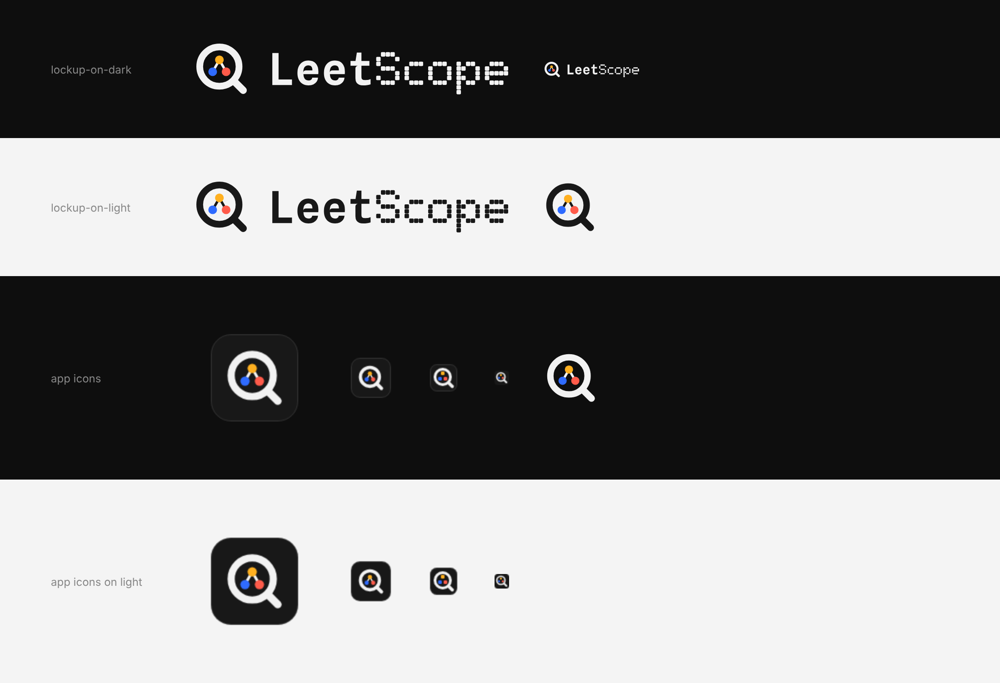
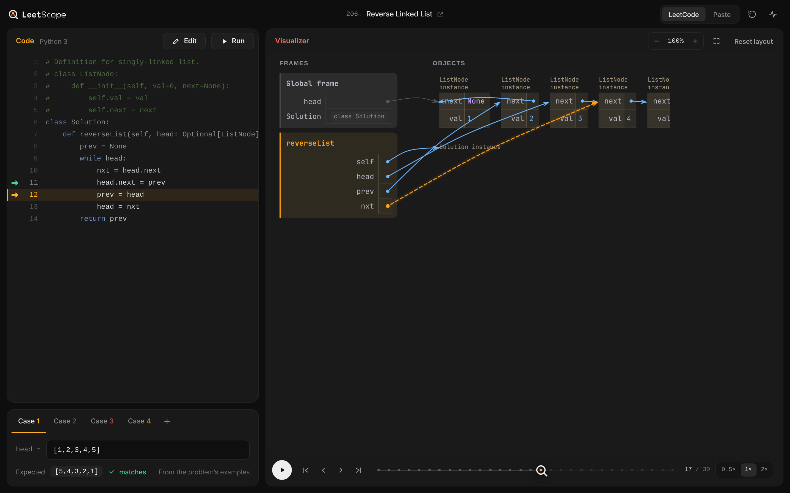
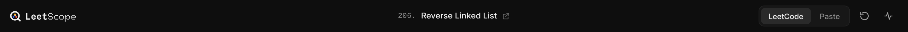
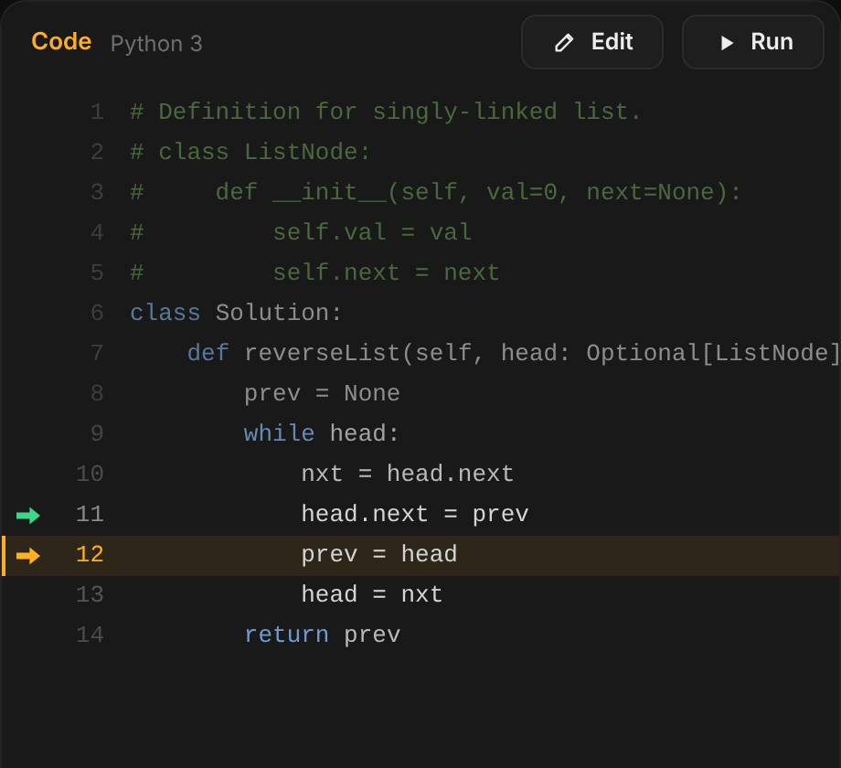
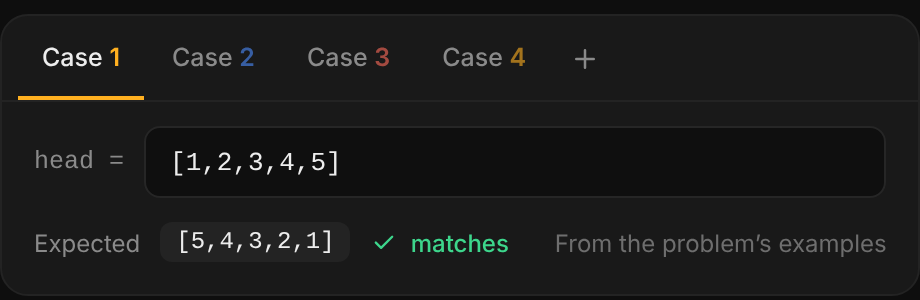
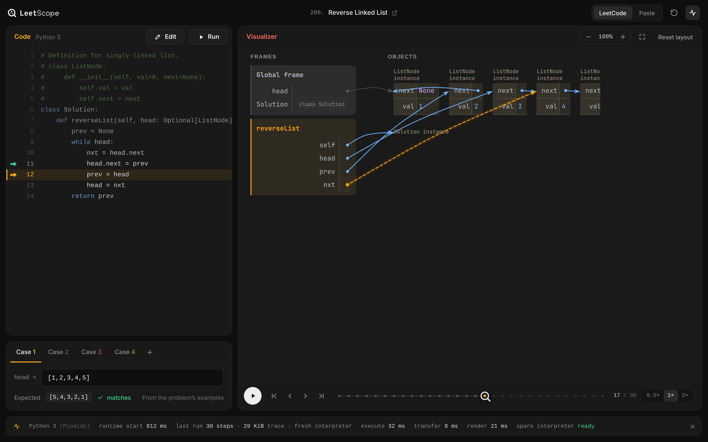
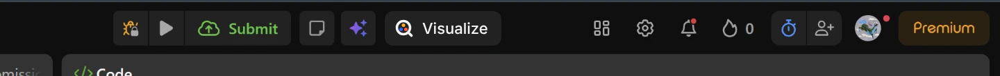
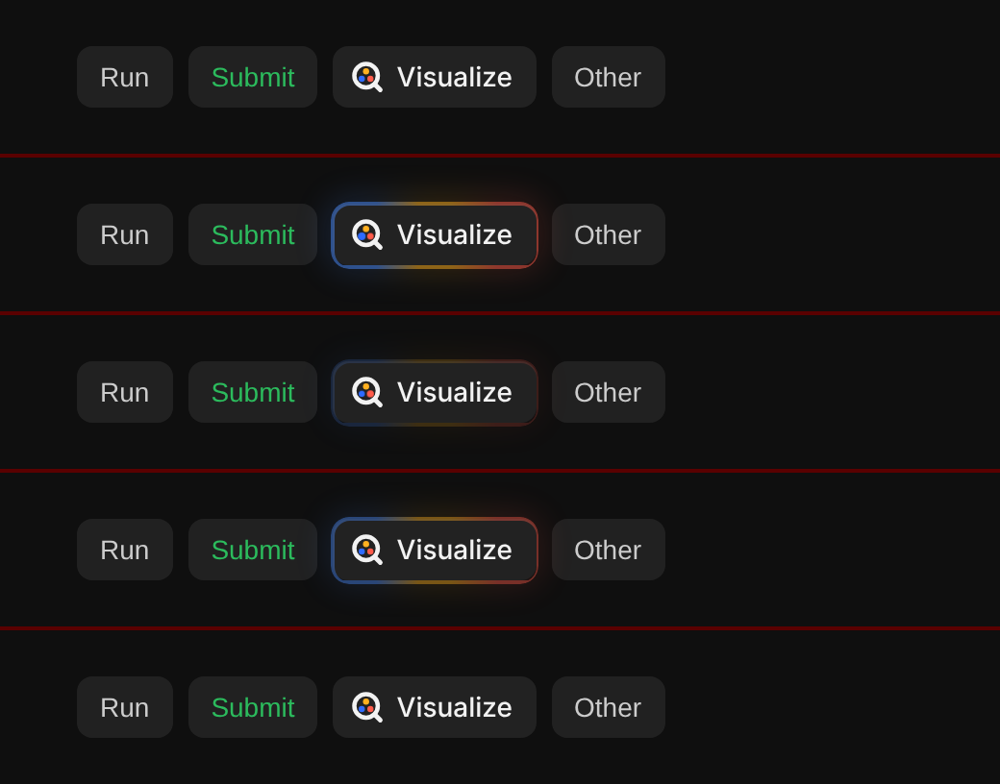

# LeetScope design handover

This folder is everything needed to build the chosen design. It covers three things:

1. **Brand**: the "Q" lockup (tree-lens mark + `Leet` in Spline Sans Mono + dot-matrix `Scope`) and the app icons.
2. **Workspace**: the "Signature" workspace (the extension's main page, dark).
3. **Visualize button on LeetCode**: the button LeetScope adds to LeetCode's top bar, and the glow it plays when LeetCode finishes a Run.

Build on the **`merge_1`** branch. It has the current UI (LeetCode mode with code tabs, test cases, Paste mode); this design restyles that UI and does not change what it does. Element IDs below are the ones in `merge_1`'s `extension/src/ui/index.html`.

The visualizer drawing itself (frames, objects, arrows, from Python Tutor) is **not** being redesigned. Leave `renderer-dark.css` and the renderer as they are; only the panel around it changes.

## Files

| Path | What it is |
| --- | --- |
| `tokens.css` | All colours, fonts, radii and motion values as CSS custom properties. Start here. |
| `leetcode-button.css` | Finished CSS for the LeetCode top-bar button, its hover/focus/opening states and the run-finished glow. Markup is in the file header. |
| `assets/brand/lockup.svg` | Full logo (mark + LeetScope). Uses `currentColor` for the ink. `lockup-on-dark.svg` / `lockup-on-light.svg` have the colour baked in. |
| `assets/brand/mark.svg` | Mark only, `currentColor` ink. Plus `-on-dark` / `-on-light` versions. |
| `assets/brand/icon-{16,32,48,128}.{svg,png}` | Extension icons for `manifest.json`. 16 and 32 are hand-drawn on the pixel grid, do not scale the 128 down instead. |
| `assets/icons/icons.svg` | Sprite of every UI icon (`<use href="icons.svg#i-play">`). Individual SVGs are next to it. Includes the code-gutter arrow and the timeline lens handle. |
| `screens/*.png` | 2x screenshots of every state, for checking your build against. |
| `reference/*.dc.html` | The design source the screenshots came from (an HTML-like design format). Every exact value is inline in these if this document misses something. Not runnable on its own. |

The logo generator lives at `extension/design/logo/make_logo.py` (needs the Spline Sans Mono 600 TTF). Re-run it rather than editing the SVGs by hand.

## 1. Colours

True neutral greys only (equal R, G, B). The owner rejected blue-tinted greys such as `#18181B`; do not reintroduce them.

| Token | Hex | Used for |
| --- | --- | --- |
| `--ls-page` | `#0E0E0E` | Page background **and** top bar (same colour, no border between them) |
| `--ls-panel` | `#191919` | Code panel, test-case panel, visualizer header, playback bar, diagnostics strip |
| `--ls-viz` | `#1A1A1A` | Visualizer drawing area (matches the renderer background, do not change) |
| `--ls-border` | `#232323` | Panel borders (1px) and dividers inside panels |
| `--ls-control` | `#1E1E1E` | Edit and Run buttons |
| `--ls-border-control` | `#2C2C2C` | Edit and Run border |
| `--ls-control-on` | `#2A2A2A` | Selected segment (LeetCode/Paste, speed), diagnostics toggle when on |
| `--ls-segment` | `#171717` | LeetCode/Paste switch track (border `#222222`) |
| `--ls-segment-speed` | `#141414` | Speed switch track (border `#222222`) |
| `--ls-input` | `#0F0F0F` | Inputs (border `#262626`) |
| `--ls-chip` | `#232323` | Value chips (Expected) |
| `--ls-hover` | `#262626` | Ghost-button hover background |
| `--ls-text-strong` | `#EDEDED` | Titles, selected labels |
| `--ls-text` | `#D4D4D4` | Code text, values |
| `--ls-text-muted` | `#A0A0A0` | Ghost buttons and icons |
| `--ls-text-dim` | `#8A8A8A` | Labels, unselected tabs, problem number |
| `--ls-text-faint` | `#6E6E6E` | Hints, "/ 30", "Python 3" |

Accents come from the logo and each has one job:

| Token | Hex | Job |
| --- | --- | --- |
| `--ls-amber` | `#FFB020` | "Now": the **Code** label, the current line, the dot in the timeline lens |
| `--ls-coral-text` | `#FF6B5B` | The **Visualizer** label; Case 3 number |
| `--ls-blue-text` | `#4C8DFF` | Case 2 number |
| `--ls-blue` / `--ls-coral` | `#2F6BFF` / `#FF5B4A` | Logo dots and the three-dot running indicator |
| `--ls-mint` | `#3DD68C` | "matches", previous-line arrow, "ready" |

Code colours: text `#D4D4D4`, comments `#6A9955`, keywords `#7FB2F0`.

## 2. Type

- **Interface**: the system stack LeetCode uses, `-apple-system, BlinkMacSystemFont, "Segoe UI", "Helvetica Neue", Helvetica, Arial, sans-serif`. 13px body, 12.5px buttons and tabs, 12px small labels. Weight 500 for buttons/tabs, 600 for panel labels.
- **Code and values**: `Menlo, Monaco, Consolas, "Liberation Mono", "Courier New", monospace`. Code 13px / 22px line height. Values and the step counter 11 to 13px.
- No web fonts in the extension. The logo is outlined SVG, so it needs no font.

## 3. Brand



**Mark**: a lens and handle (64-unit grid) holding a three-node tree.
- Ring: centre (28,28), r 19, stroke 6.5. Handle: (42,42) to (51,51), stroke 7, round cap. Ink is `#181818` on light, `#F2F2F2` on dark.
- Tree: lines from (28,21.5) to (21.5,33) and (34.5,33), stroke 2.4 in the ink colour. Dots r 4.2: top amber `#FFB020`, left blue `#2F6BFF`, right coral `#FF5B4A`.
- Below 48px use the simplified cut (in `icon-16`/`icon-32`): no lines, larger dots.

**Wordmark**:
- `Leet` is Spline Sans Mono 600, outlined, normal tracking.
- `Scope` is a dot grid on a 100-unit pitch, 7 rows (2 more for the `p` descender), dots 94 with radius 20. The `c` is 4 columns wide and open on the right so it can't be read as `o`. There is exactly one empty column between letters.
- `Scope` is drawn 1.07x the size of `Leet`, so the lowercase heights match. It starts 0.045em after the `t`.
- The mark is 1.5em tall with a 0.26em gap to the text, centred on the text.
- All of this is already built into `lockup.svg`. Use the file, do not re-typeset.

**Sizes**:
- Workspace top bar: lockup **17px tall**.
- Extension icons: `icon-16/32/48/128.png`, a dark tile `#181818` with a light mark. The 128 follows Chrome's 96px art area with 16px padding.
- Don't: recolour the dots, put the mark in an orange tile, add a glow or drop shadow, or stretch the lockup.

## 4. Workspace



Other states: `screens/workspace-start-step1.png`, `workspace-playing.png`, `workspace-diagnostics-open.png`, `detail-*.png`.

### Layout (1440 x 900 reference)

```
┌ top bar 52px, bg page, no border ─────────────────────────────────────────────┐
│ [lockup 17px]            206. Reverse Linked List ↗          [LeetCode|Paste] ⟲ ∿ │
├───────────────────────────────────────────────────────────────────────────────┤
│ 12px                                                                    12px  │
│ ┌ code panel ──────────────┐ 12 ┌ visualizer panel ──────────────────────────┐ │
│ │ Code  Python 3  [Edit][Run]│   │ Visualizer              [− 100% +] ⛶ Reset │ │
│ │ ─────────────────────────│   │ (renderer, unchanged)                      │ │
│ │ code with gutter arrows  │   │                                            │ │
│ └──────────────────────────┘   │                                            │ │
│ 12                              │                                            │ │
│ ┌ test cases panel ────────┐   │ ▶ |◀ ◀ ▶ ▶| ·······🔍········ 17 / 30 [.5 1 2]│ │
│ │ Case 1 Case 2 Case 3 +    │   └────────────────────────────────────────────┘ │
│ │ head = [1,2,3,4,5]        │                                                  │
│ │ Expected [5,4,3,2,1] ✓ matches          From the problem's examples │      │
│ └──────────────────────────┘                                                   │
│ (diagnostics strip, full width, only when toggled on)                          │
└───────────────────────────────────────────────────────────────────────────────┘
```

- `main`: padding `0 12px 12px`, gap 12px, flex row that wraps.
- Left column: `flex: 1 1 460px; max-width: 600px`, a column with 12px gap. The code panel grows; the test-case panel is natural height.
- Right column (visualizer): `flex: 999 1 560px`.
- Panels: bg `#191919`, 1px `#232323` border, radius 14px, overflow hidden.
- Scrollbars: thin, thumb `#2A2A2A`, transparent track.

### Top bar (52px)



- A three-column grid (`1fr auto 1fr`), padding `0 16px`, background `#0E0E0E`, no border, gap 16px.
- **Left**: the lockup, 17px tall, `#EDEDED` ink. Replaces the old `#ls-logo-bg` SVG.
- **Centre**: the problem chip (`#lc-title` + `#lc-badge`). It's a link to the problem: 30px tall, padding `0 10px`, radius 8px, no fill, hover text white. Inside are `206.` (mono 12px 500, `#8A8A8A`), the title (13px 500, `#EDEDED`), and an external-link icon (13px, `#6E6E6E`).
- **Right**, 8px gap:
  - `#mode-toggle` as a two-option segmented switch (LeetCode / Paste). Track `#171717` with a `#222222` border, padding 3px, radius 9px. Options are 26px tall, padding `0 12px`, 12px 500. Selected: bg `#2A2A2A`, text `#EDEDED`. Unselected: `#8A8A8A`, which turns `#EDEDED` on hover.
  - `#reset` and `#diag-toggle` as 30x30 ghost icon buttons (16px icons).
- **No status pill.** The owner removed it ("Done", "Ready"). Status that matters is shown elsewhere: the running dots on Run, and messages in the visualizer panel (see States).

### Code panel



- **Header**: 44px, padding `0 8px 0 16px`, gap 10px, no divider below it.
  - `Code` in 600 `#FFB020`, then `Python 3` in 12px `#6E6E6E`.
  - If you keep `merge_1`'s code tabs (`.code-tabs`), put them after `Python 3` as quiet text tabs in 12.5px: unselected `#8A8A8A`, selected `#EDEDED`. Don't add another colour.
  - **Edit and Run**, right-aligned, a matched pair. Both: height 30px, min-width 78px, padding `0 12px`, gap 7px, 1px `#2C2C2C` border, radius 8px, bg `#1E1E1E`, text `#EDEDED` 600 12.5px, 14px icon. Hover bg `#262626`, active `scale(.93)`. Neither is filled white or amber.
  - **Edit** maps to `#edit`.
  - **Run** maps to `#case-run` in LeetCode mode and `#visualize` in Paste mode. Its tooltip is "Run this case (Ctrl+Enter)"; the shortcut is not printed on the button.
- **Code body**: 6px top padding, 10px bottom, Menlo 13px/22px.
  - **Gutter**: a 26px arrow column, then line numbers in 30px with 14px right padding, right-aligned.
  - **Line numbers**: `#555555`. The current line's number is `#FFB020`, and the line that just ran is `#8A8A8A`.
  - **Current line**: a band across the full width, bg `rgba(255,176,32,.09)` with `inset 2px 0 0 #FFB020`. It is one absolutely positioned element that **glides** to the new line: `top` transition .3s `cubic-bezier(.3,.7,.2,1)`.
  - **Arrows** (`assets/icons/line-arrow.svg`, 15x12): amber on the current line, mint `#3DD68C` on the line that just ran. Both glide the same way. The mint arrow fades out if there's no previous line.
  - **Focus dimming**: lines fade by distance from the current line. Distance 0 or 1 is opacity 1, 2 is .86, 3 is .74, 4 or more is .62, with a .35s opacity transition. It's subtle on purpose: the eye lands on the running line.

### Test-case panel (`#lc-cases`)



- **Tabs** (`#case-tabs`): 42px tall, padding `0 12px`, 12.5px 500. Unselected: `#8A8A8A`, hover `#EDEDED`. Selected: text `#EDEDED` with a 2px underline in that case's colour (`inset 0 -2px 0 <colour>`).
  - The **number** in each tab is coloured. Colours cycle amber `#FFB020`, blue `#4C8DFF`, coral `#FF6B5B`, then repeat, so Case 4 is amber again. The number is opacity 1 when selected and .6 otherwise.
  - Use no dots or icons in the tabs.
  - `#case-add` is a 30px ghost `+`.
- **Body**: padding `12px 16px 16px`, divider `#232323` above, 12px gap.
  - **Field row** (`#case-fields`): the label (`head =`, mono 12.5px `#8A8A8A`) sits left of the input. The input is 36px tall, bg `#0F0F0F`, 1px `#262626` border, radius 8px, mono 13px `#EDEDED`.
  - **Result row**: `Expected` (12px `#8A8A8A`), then a chip (`#case-expected`, bg `#232323`, radius 6px, padding `3px 8px`, mono 12px), then the verdict (`#case-verdict`).
    - A match shows as `✓ matches` in `#3DD68C` 12px 500, with no box.
    - A mismatch shows as a coral card, described under States.
  - `#case-source` ("From the problem's examples") is right-aligned in 12px `#6E6E6E`.

### Visualizer panel (`#viz`)

- **Header**: 44px, bg `#191919`, padding `0 8px 0 16px`, gap 8px.
  - `Visualizer` in 600 `#FF6B5B` on the left.
  - On the right: the zoom group (−, 100%, +) in a 30px box with a 1px `#262626` border and radius 8; `100%` is mono 12px `#D4D4D4`. Then a fit-to-view icon button and a `Reset layout` text button (12px 500 `#A0A0A0`).
  - These replace the renderer's own floating zoom controls.
- **Body**: the renderer, unchanged, on `#1A1A1A`.
- **Playback bar** (`#player`): 58px, bg `#191919`, padding `0 16px 0 11px`, gap 10px. In order:
  1. **Play** (`#play`): a 36px circle, bg `#EDEDED`, icon `#111111` (play nudged 2px right; pause centred). Hover adds a ring `0 0 0 5px rgba(255,255,255,.07)`; active `scale(.9)`. The button stays white, not amber.
  2. **Step buttons**: `#nav-first`, `#nav-prev`, `#nav-next`, `#nav-last` as 30px ghost buttons with 15px icons, 2px apart.
  3. **Timeline** (`#step-meter`), styled as a slider: flex 1, 32px tall, 10px side margins, clickable and draggable.
     - Track: 1px `#262626` at mid-height. The played part is 1px `#4A4A4A`, with a width transition of .3s glide.
     - One 4x4 tick per step (radius 1px) spread evenly: played `#5A5A5A`, ahead `#313131`. Above roughly 120 steps, drop the ticks and keep just the track.
     - Handle: `assets/icons/lens-handle.svg` (26x26), a small magnifying glass. Its (11,11) point sits on the current step: `left: <pct>; margin: -11px 0 0 -11px; top: 50%`. It has `left .3s` glide and `drop-shadow(0 2px 6px rgba(0,0,0,.55))`.
     - While playing, the amber dot inside the lens breathes: r 2.6 to 3.4 to 2.6 over 1.1s.
  4. **Step counter**: plain text, mono 11px 500. The step is `#D4D4D4`, followed by ` / 30` in `#6E6E6E`. Min-width 40px. Keep it small; the owner rejected larger dotted versions.
  5. **Speed** (`#speed`): a segmented switch with 0.5×, 1×, 2×. Track `#141414` with a `#222222` border, padding 2px, radius 8px. Options are 24px tall, padding `0 8px`, mono 11px 500. Selected: `#2A2A2A` / `#EDEDED`. Unselected: `#8A8A8A`.

### Diagnostics (`#diag`)



- **Toggle**: `#diag-toggle`. When it's on, the icon is `#FFB020` on a `#2A2A2A` background and `aria-pressed="true"`.
- **Strip**: a full-width strip at the **bottom** of the page, below both columns (it is not a floating popover). It has margin `0 12px 12px`, min-height 38px, padding `6px 6px 6px 14px`, a 1px `#232323` border, radius 12px and bg `#191919`. The panels above shrink to make room.
- **Content**: one wrapping line of mono 11.5px `#8A8A8A`. It starts with a 14px amber pulse icon. Values are in `#D4D4D4`, and "ready" is in `#3DD68C`. A 26px ✕ at the end closes it.
  - Show the same facts `renderDiag()` already builds: the Python version, runtime start time, the last run's steps and trace size, execute / transfer / render times, and whether the spare interpreter is ready.

### States

- **Running**: Run shows three 5px dots (amber, `#2F6BFF`, `#FF5B4A`) hopping 4px, .9s, staggered .12s (`screens/detail-run-running.png`).
  - While they show, the button's label and tooltip become Stop, and clicking it does what `#stop` does.
  - Return to `Run` when the run ends.
- **Messages in the visualizer panel** (`#message`, placeholders `#empty` / `#lc-empty`): keep their current wording. Restyle them as follows.
  - **Neutral information**: plain text in `#A0A0A0`.
  - **Wrong output**: a card with bg `rgba(255,107,91,.08)`, a 1px `rgba(255,107,91,.25)` border and radius 10. The title "Output differs" is in `#FF6B5B` 500; the detail line is mono 12px `#D4D4D4`.
  - **Step limit or time limit**: bg `rgba(255,176,32,.07)`, a 1px `rgba(255,176,32,.22)` border, text `#F2C46D`.
- **Hover and press**: every ghost button gets bg `#262626` and text white on hover, and `scale(.93)` on press.

### Motion summary

| What | Value |
| --- | --- |
| Current-line band, arrows, timeline handle and fill | `.3s cubic-bezier(.3,.7,.2,1)` |
| Code focus dimming | opacity `.35s ease` |
| Lens dot while playing | radius 2.6 to 3.4, `1.1s ease-in-out infinite` |
| Running dots | `translateY(-4px)`, `.9s`, delays 0 / .12 / .24s |
| Buttons | background `.15s`, press scale `.1s` |

Wrap every animation in `@media (prefers-reduced-motion: reduce) { animation: none; transition: none }`.

### Accessibility

- Real `<button>`s with `aria-label`s on every icon button (Reset, Diagnostics, Zoom out/in, Fit to view, First/Previous/Next/Last step, Play/Pause).
- The timeline is `role="slider"` with `aria-valuemin`, `aria-valuemax` and `aria-valuenow`, and it works with the existing keys (← →, Shift+← →).
- The step counter carries `aria-label="Step 17 of 30"`.
- Focus ring: `2px solid #FFB020`, `outline-offset: 2px`, on `:focus-visible` only.
- Coloured case numbers and line colours are never the only cue: the selected tab also has weight and an underline, and the current line also has the arrow.

## 5. Visualize button on LeetCode



`extension/src/content/leetcode-button.js` already injects `#visualleet-top-button` into `#ide-top-btns`. Keep that logic and replace the styling with `leetcode-button.css`. The file's header has the exact markup.

**Look**:
- 32px tall, radius 8px, padding `0 12px 0 9px`, gap 6px, 14px 500 label "Visualize", and the 18px mark on the left.
- Solid `#222222` fill (hover `#2B2B2B`), so it sits with LeetCode's own buttons, and a **white** label `#F2F2F2`.
- No amber text, no orange tint, and no `</>`.
- The only colour is the three dots in the mark.

**Light theme**: bg `#F0F0F0`, text `#262626`. The CSS assumes LeetCode puts `dark` on `<html>` in dark mode; check this on the live site.

**Opening state**: while `visualize-page` is in flight, swap the label for three 4px dots (`.ls-vz-hop`, same colours as the app's running dots) for at least 600ms, then restore it.

### Run-finished glow



**Purpose**: a reminder that LeetScope is there. When the user presses **LeetCode's own Run** (not ours) and LeetCode shows the result, our button glows once. It is not a click effect.

**Look**:
- A thin 1.5px edge with a left-to-right gradient: blue `#4C8DFF`, then amber `#FFB020`, then coral `#FF5B4A`. Amber sits in the middle so blue and coral never meet, which would read as purple.
- A faint blurred haze of the same gradient behind the button (blur 9px).
- Two soft pulses over 2.6s, then fully gone. Edge opacity goes 0, .48, .16, .42, 0; haze goes 0, .17, .06, .14, 0.
- The three dots in the mark swell to 1.25x one after another (delays .15, .33, .51s), twice.
- Off for reduced motion.
- The owner asked for this to stay subtle. Don't increase the opacity, blur or spread.

**Trigger**: add `ls-vz-glow` to `.ls-vz-wrap`. To replay it, remove the class, force a reflow (`void el.offsetWidth`), then add it again; remove it on `animationend`. Fire once per finished run:
- In the content script, watch for LeetCode's run result to appear or change (the Test Result panel's verdict, e.g. "Accepted", "Wrong Answer", "Runtime Error") after the Run button was pressed.
- `merge_1`'s `leetcode-reader.js` already reads `data-e2e-locator` markers; use the same approach.
- **Verify the exact selectors on the live site.** Likely candidates are `data-e2e-locator="console-run-button"` for Run and the result container in the Test Result tab. Don't rely on these without checking.
- Don't fire on page load, on Submit, or more than once per run.

### Messages under the button

`screens` doesn't include these; see `reference/leetcode-button-states.dc.html`. These replace the orange-bordered toast in `leetcode-button.js`.

- **Card**: 360px wide, padding `12px 12px 14px 14px`, radius 12px, bg `#1E1E1E`, 1px `#303030` border, shadow `0 16px 40px rgba(0,0,0,.5)`. Text is 13px/1.5 `#C8C8C8`.
- **Header**: the 16px mark plus "LeetScope" in 600 `#F5F5F5`, with a 24px ghost ✕ on the right (`#8A8A8A`, hover `#F5F5F5` on `#2C2C2C`).
- **Action** (at most one, e.g. "Use Example 1"): 28px tall, padding `0 10px`, radius 7px, bg `rgba(255,255,255,.1)` (hover `.17`), text `#F5F5F5` 500 12.5px.
- **Position and lifetime**: 8px below the button, left-aligned to it and clamped to the viewport. Keep the existing 20s auto-dismiss.

## 6. Writing style for any new text

Plain and professional, like LeetCode's or Google's product pages:
- No `·` separators.
- No colons or dashes used for effect.
- No exclamation marks.
- Use sentence case.

## 7. Not in scope / open items

- The landing page design is on the design canvas but was not chosen for this handover.
- Its claims still need confirming before any public use: works offline, problem count. `background.js` still says the database "covers the NeetCode 150 for now" while the repo has about 1,026 problems. Fix that message when you touch the toast code.
- Check the extension icons at 16px in Chrome's real toolbar, in both light and dark themes.
